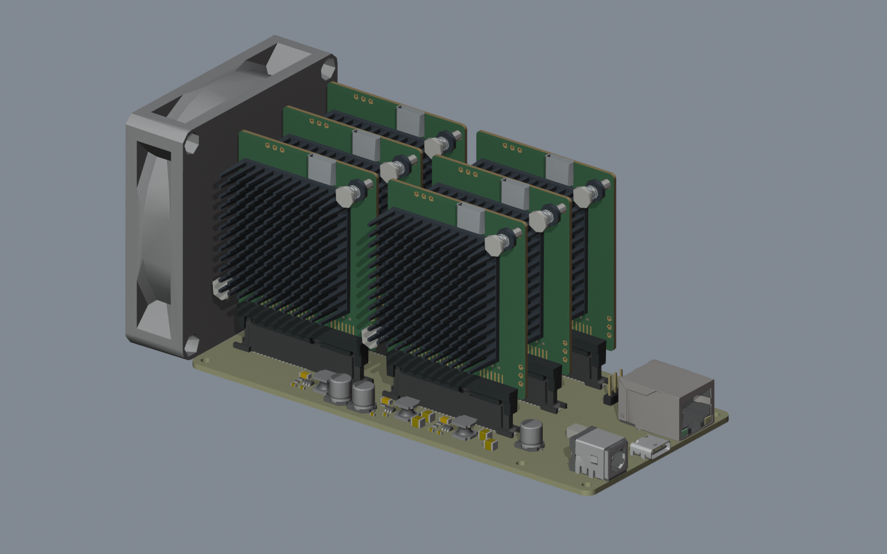

# Top-Side Power Placement

三路降压电源放在 PCB 顶面前沿，12 V 储能电容 C1 放在接口区内侧。换面涉及 C1、F1、J11，以及 U2–U4、L1–L3、C7–C24、R5–R10，共 33 个器件。三路降压的芯片、电感、输入输出电容及反馈阻容一起换面。

## Capacitor Functions

| Reference | Value / Rating | Rail | Function |
| --- | --- | --- | --- |
| C1 | 100 µF / 25 V | BUS_12V | 12 V 主电源母线储能，缓冲负载电流变化，减轻线缆及供电路径阻抗引起的电压波动 |
| C23, C24 | 100 µF / 10 V each | SW_1V1 | U4 降压输出并联的 200 µF 电容组，滤除纹波，并在交换芯片负载突变时提供瞬态电流 |
| C11, C12 | 22 µF / 25 V each | SYS_5V | U2 的 5 V 输出滤波与瞬态支撑 |
| C17, C18 | 47 µF / 16 V each | SW_3V3 | U3 的 3.3 V 输出滤波与瞬态支撑 |
| C7, C13, C19 | 10 µF / 50 V each | Regulator inputs | 各路降压输入去耦，为开关电流回路提供就近电荷 |

三颗圆柱形大电容是 C1、C23 和 C24。标注中的 25 V、10 V 是耐压等级，对应的实际工作电压分别为 12 V 和 1.1 V。三个方形大件 L1–L3 是电感，与输出电容共同构成降压电源的滤波网络。

输出电容同时影响纹波、负载瞬态响应和控制环路稳定性；容量、ESR 与纹波电流额定值需结合样机确认。布局按 [TPS54302 官方资料](https://www.ti.com/lit/ds/symlink/tps54302.pdf) 的输入输出电容靠近芯片、缩短开关节点路径和隔离反馈路径要求继续布线。

## Validation

以下结果对应顶面供电换面时的工程快照。

- EDA 加载了当时的 206 个组件。换面前后的 847 条焊盘网络映射及六个安装孔一致。
- 新增顶面器件焊盘与现有顶面焊盘无面积重叠。
- 大件包络对项目中的六块 845 核心板 STEP 模型进行 CAD 表面测距，最小间隙约 4.68 mm；母座区域按其包络避让。
- EDA 实际导出中，底面最低点由约 −10.17 mm 变为 −4.00 mm，包含连接器引脚。
- 已清除 417 段受移位影响的旧走线；电源区需要重新布线、铺铜及 DRC。

坐标和检查结果见 [Placement Data](top-power-placement.json) 与 [Mechanical Check](top-power-mechanical-check.json)。

[Native EDA Assembly](../../../enclosure/assembly/preview/mci-845-eda-assembly-140x65-7020.glb) · [Bottom View](../../../enclosure/assembly/preview/eda-backplane-bottom.png)

