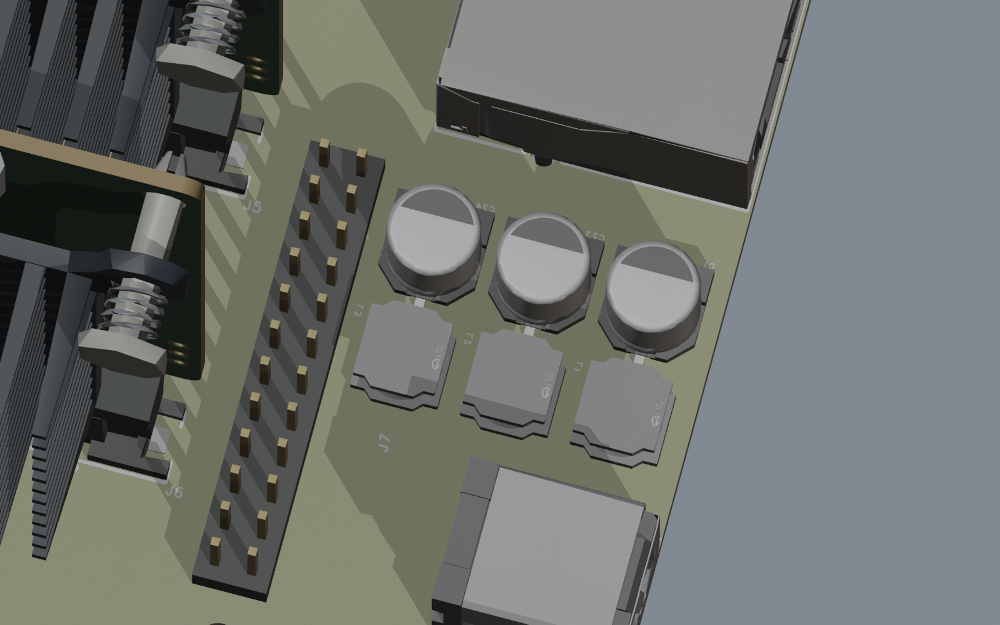
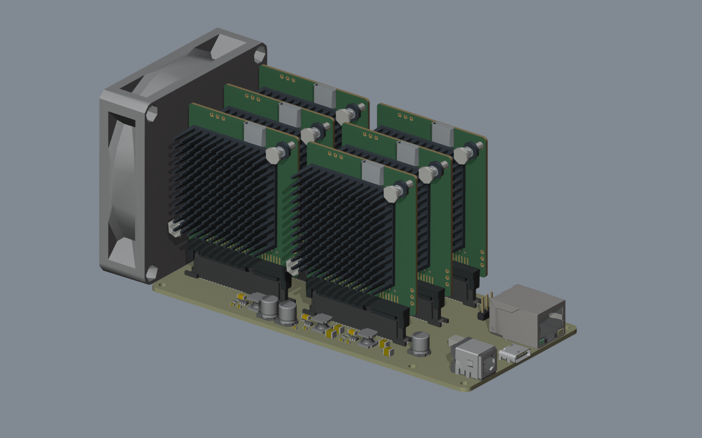

# Top-Side Power Placement

从顶面看，RJ45 下方第一排从左到右是 C24、C23、C1，中心 Y = 32.92 mm，中心距 7.5 mm。第二排是 L3、L2、L1，中心 Y = 25.12 mm，中心距 7.5 mm。三颗电容的负极条均朝 +Y，对应 2 脚 GND。三颗电感的 1 脚均朝 −Y，对应各自的开关节点。两排共用三条列中心线，X 坐标依次为 113.43、120.93、128.43 mm。两排大件到上方 RJ45 和下方 J7 的净距均约 4.12 mm。三颗降压芯片及其反馈、去耦和自举器件位于背面。Zero 下方大件和杜邦插头的装配净空按实际铜柱高度核对。

背面 U4 的开关节点 U4_SW 接顶面电感 L3。C22 连接 BOOT 与 SW，输入旁路和反馈网络均已布线。

## Unpopulated 5 V Supply

5 V 支路的 U2、L1、R5、R6、C7–C12 固定空焊，J11 第 9 脚留空。U3 和 U4 的 VIN 及各自输入电容直接连接电子保险后的 BUS_12V。

按 12 V 输入、3.361 V 和 1.118 V 输出，理想连续导通模式下，400 kHz 时两路所需导通时间分别约为 700 ns 和 233 ns；按 510 kHz 核算分别约为 549 ns 和 183 ns。TI 给出的最小导通时间为 110 ns 典型值。保留 L2 = 6.8 µH 和 L3 = 2.2 µH，在 290 kHz、标称电感量下，估算电感峰峰纹波分别为 1.23 A 和 1.59 A。按负载电流加半个纹波核验峰值电流，并计入输入电压和电感容差。首件需测量 12 V 偏压下输入旁路效果、六槽启动与端口满载时的磁珠后电压、复位和 U3/U4 温升。[TI TPS54302 数据手册](https://www.ti.com/lit/ds/symlink/tps54302.pdf)

## Capacitor Functions

| Reference | Value / Rating | Rail | Function |
| --- | --- | --- | --- |
| C1 | 100 µF / 25 V | BUS_12V | 12 V 主电源母线储能，缓冲负载电流变化，减轻线缆及供电路径阻抗引起的电压波动 |
| C23, C24 | 100 µF / 10 V each | SW_1V1 | U4 降压输出并联的 200 µF 电容组，滤除纹波，并在交换芯片负载突变时提供瞬态电流 |
| C11, C12 | 22 µF / 25 V each | SYS_5V | 5 V 支路预留焊位，固定空焊 |
| C17, C18 | 47 µF / 16 V each | SW_3V3 | U3 的 3.3 V 输出滤波与瞬态支撑 |
| C7, C13, C19 | 10 µF / 50 V each | Regulator inputs | 各路降压输入去耦，为开关电流回路提供就近电荷 |

三颗圆柱形大电容是 C1、C23 和 C24。标注中的 25 V、10 V 是耐压等级，对应的实际工作电压分别为 12 V 和 1.1 V。三个方形大件 L1–L3 是电感，与输出电容共同构成降压电源的滤波网络。

输出电容同时影响纹波、负载瞬态响应和控制环路稳定性；容量、ESR 与纹波电流额定值需结合样机确认。样机上分别测量 U3、U4 的输出纹波及负载阶跃响应。[TPS54302 数据手册](https://www.ti.com/lit/ds/symlink/tps54302.pdf)

## Validation

以下结果对应顶面供电换面时的工程快照。

- EDA 加载了当时的 206 个组件。换面前后的 847 条焊盘网络映射及六个安装孔一致。
- 新增顶面器件焊盘与现有顶面焊盘无面积重叠。
- 大件包络对项目中的六块 845 核心板 STEP 模型进行 CAD 表面测距，最小间隙约 4.68 mm；母座区域按其包络避让。
- EDA 实际导出中，底面最低点由约 −10.17 mm 变为 −4.00 mm，包含连接器引脚。

首次换面的坐标和检查结果见 [Placement Data](top-power-placement.json) 与 [Mechanical Check](top-power-mechanical-check.json)。当前坐标见 [Backplane PCB](../../pcb/Backplane.epcb2)，整板布线和 DRC 结果见 [Fabrication](../../README.md#fabrication)。

[Native EDA Assembly](../../enclosure/assembly/preview/mci-845-eda-assembly-140x65-7020.glb) · [Bottom View](../../enclosure/assembly/preview/eda-backplane-bottom.png)

