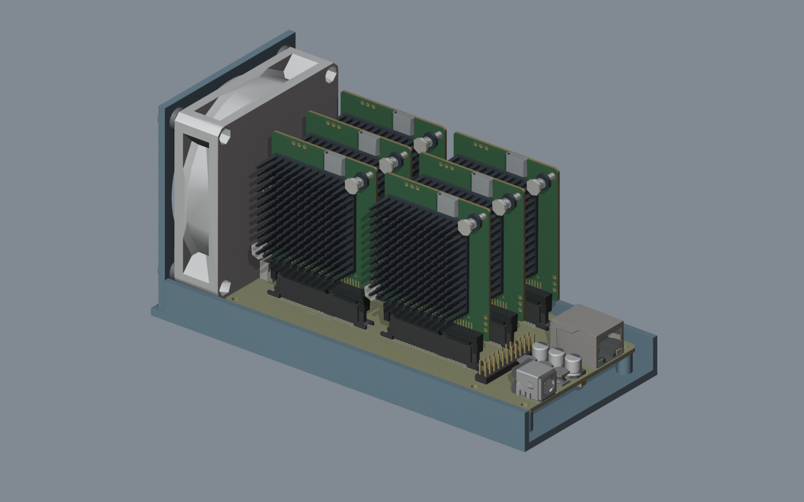

# Printed Base

当前 140 × 65 mm 底板使用两件式开放底座：低边托盘承托 PCB，可拆风扇面板固定左侧 7020 风扇。两者通过底座连接，风扇载荷由打印结构承受。顶部保持开放，右侧接口区无端墙。

[Interactive assembly](preview/printed-base-140x65-7020.glb) · [Tray STL](print/printed-base-tray.stl) · [Fan panel STL](print/printed-base-fan-panel.stl) · [Editable STEP](cad/printed-base-assembly.step)

目录入口：[打印文件](print/) · [CAD](cad/) · [预览](preview/) · [检查记录](checks/)

## Dimensions

沿用 EDA 原点，PCB 顶面 Z = 0，板厚按 1.6 mm。托盘占地 172 × 77 mm，底板厚 3 mm；两侧挡边高至 Z = 3 mm。含风扇面板的打印结构总高 86 mm。外露螺丝头和外贴脚垫另计。

| Feature | Dimension |
| --- | --- |
| Tray print envelope | 172 × 77 × 16 mm |
| Fan panel print envelope | 86 × 76 × 3 mm |
| PCB underside / support height | Z = −1.6 mm / 8.4 mm above floor |
| Floor top / bottom components | Z = −10 / −4.27 mm，净空 5.73 mm |
| Fan aperture | Ø68 mm |
| Fan bolt pitch / clearance holes | 61.5 × 61.5 mm / Ø5.5 mm |
| Panel-to-fan spacer | 2 mm |
| Sidewall-to-fan clearance | 1 mm on each side |

六个 PCB 支撑柱中心直接对应当前六个 Ø2.9 mm 安装孔。支撑柱外径 6 mm，顶部在 PCB 底面。四个 Zero 孔位也有底部支撑；安装 Zero 时可用合适长度的 M2.5 外螺纹铜柱代替该处螺钉，上方高度由用户的接线和散热方案确定。

## Fastening

| Item | Quantity | Purpose |
| --- | ---: | --- |
| 5 × 10 mm fan self-tapping screws | 4 | 从外侧穿过面板及 2 mm 垫片，拧入风框外侧安装孔约 5 mm |
| 2 mm silicone spacers, bore ≥5.5 mm | 4 | 位于面板和风框之间，提供间隙和减振 |
| M3 × 10 mm plastic-thread screws | 2 | 风扇面板固定到底座的下部耳座 |
| M2.5 × 6 mm plastic-thread screws | 6 | PCB 固定到支撑柱；先装全部螺钉，再轻拧紧 |
| Adhesive rubber feet, ≥3 mm high | 4 | 为底部通风槽留出进气间隙 |
| 70 mm metal fan guard | 1 | 安装在外部进风面，按实际厚度复核风扇螺丝长度 |

风扇安装螺丝从外侧拧入：面板厚 3 mm、减振垫片厚 2 mm，10 mm 螺丝在外侧风框中咬合约 5 mm，末端位于 X = −22 mm，距朝向核心板的风框端面还有 15 mm。风框内侧不安装螺母。原贯穿 M4 螺栓方案在右上角的螺母与 845 模型发生干涉，已改为短款风扇自攻螺丝。首件按风框实际材料和 Ø4.3 mm 孔径确认螺纹咬合，锁紧时避免撑裂孔壁。风向按风框箭头设置为从左向右吹过 845 散热片。

面板底部两个 10 mm 宽定位舌插入托盘槽；槽在厚度、宽度方向均预留总计 0.4 mm 间隙。两颗 M3 螺钉从外侧穿过面板，拧入下部耳座。耳座在风框下方，保留 2 mm 高度净空。PCB 孔使用 Ø2.1 mm、深 7 mm 的盲底孔；M3 耳座使用 Ø2.5 mm 导孔。导孔适用于塑料专用螺钉，先用同材料小样确认咬合，孔径可在源文件中调整。

## Printing and Assembly

建议先用 PETG 打样，0.2 mm 层高、4 道壁、5 层顶底和 25–35% 填充。两个 STL 已分别转为平放、底面 Z = 0 的打印方向，均无须支撑。面板为 3 mm 平板，打印后转为竖直安装。保持风扇圆孔和底部通风槽畅通。

1. 打印托盘和面板，清理导孔与定位槽，安装底部橡胶脚垫。
2. 以四颗短款风扇自攻螺丝将风扇固定到面板，加入 2 mm 减振垫片，安装护网。
3. 插入面板定位舌，用两颗 M3 螺丝锁到底座耳座。
4. 放入底板，核对六个孔位和底部器件间隙，用 M2.5 螺丝固定。
5. 插入六块 845，连接风扇，确认接口插拔、风向及工作温度。

## Verification

两个打印件均为有效的单一实体，STL 网格封闭；面板与托盘装配实体交叠体积为 0。底部器件距托盘底面 5.73 mm，PCB 固定孔沿用当前 EDA 六孔坐标，风扇固定孔沿用[台达官方尺寸](https://www.delta-fan.com/Download/Spec/AFC0712DD-TP10.pdf)。检查结果见 [Geometry checks](checks/printed-base-check.json)。首件需验证打印收缩、塑料螺钉咬合及风扇紧固件工具空间；运行温度由实机负载测试确认。
