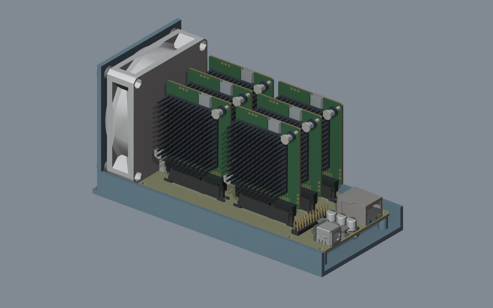

# Assembly Models

本目录记录当前底板装配使用的 3D 模型。Zero 的安装与接线见 [Four-Post Dupont Mount](../enclosure/assembly/zero-dupont-mount.md)。

## Local Library

MECH1–MECH6 共用[核心板竖插 STEP](../845-coreboard/eda-models/mci-845-coreboard-vertical.step)。MECH8 加载[台达 7020 风扇 STEP](mci-845-delta-7020.step)。工程保留 STEP 原件，EDA 从已登记的本地模型库加载。换机时将这两个 STEP 及下方的外壳 STEP 放入新机器的模型库，并在 PCB 的 3D 模型管理器中核对库路径。

7020 模型来自台达官方 STEP。辅助排针为尺寸参考模型。Zero 3W 的机械资料见 [Radxa 官方资源](../reference-models/radxa-zero-3w/README.md)。铜柱与加高排母 STEP 是历史试排资源。

MECH9 引用[外壳装配 STEP](../enclosure/printed-base/cad/printed-base-assembly.step)，按 PCB 原点放置托盘和风扇面板。

## Component Packages

`model-bindings.csv` 和 `model-bindings.json` 记录电气元件及新增机械件的模型绑定。六块核心板共享 `mci-845-coreboard-vertical.step`。常规芯片、阻容、电感及连接器使用 EDA 目录中的封装模型，CH348L 使用 LQFP-100、14 × 14 mm 本体模型。保险、电感和辅助排针采用对应包络的参考模型。

## Preview

[Native EDA Assembly](../enclosure/assembly/preview/mci-845-eda-assembly-140x65-7020.glb) 由 EDA 原生三维导出转换，导出时关闭缺失模型自动生成。
